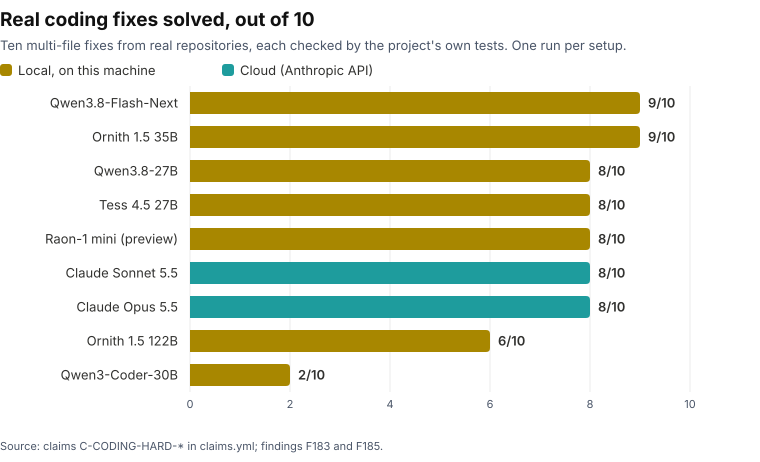

# Local AI for a Small Firm - the data

This repository is the data package behind **[Local AI for a Small Firm: What a 128 GB Mini-PC Can Actually Do](https://humanspark.ai/local-ai/)** - independent research into what a EUR 3,680 on-premises mini-PC (GMKtec EVO-X2, Ryzen AI Max+ 395, 128 GB unified memory) can do for a small professional practice.

**If you want the findings, read the report, not this repo.** The plain-English argument, the verdict, and the practical guidance live on the website:

- [The Report](https://humanspark.ai/local-ai/) - the argument and the verdict
- [In Practice](https://humanspark.ai/local-ai/in-practice/) - which model for which job, setup, media results
- [The Evidence](https://humanspark.ai/local-ai/evidence/) - every finding, method, and correction, rendered readably

This repository exists so that the numbers on those pages do not have to be taken on trust.

> [!NOTE]
> **The machine**
> - **Computer:** GMKtec EVO-X2 mini-PC, EUR 3,680
> - **Processor and graphics:** AMD Ryzen AI Max+ 395 with Radeon 8060S integrated graphics
> - **Memory:** 128 GB unified, shared by processor and graphics; about 105 GB of it usable by the graphics
> - **Power:** 81 to 87 W package power while generating ([F180](FINDINGS.md#f180))
> - **Measured:** one machine, July 2026 to 13 November 2026; engines include llama.cpp, Halogen, Talus, gufo and Strata

<picture>
  <source media="(prefers-color-scheme: dark)" srcset="assets/coding-results-dark.svg">
  
</picture>

Ten real multi-file fixes, scored by each project's own tests ([F183](FINDINGS.md#f183), [F185](FINDINGS.md#f185)). The local setups ran at each model's default reasoning effort, which for Qwen3.8-Flash-Next is its highest setting; whether a lower one keeps the score is being measured. The best local setup took a median of 21.3 minutes per task against 2.5 for Claude Sonnet 5.5.

| Setup | Runs on | Solved | Median minutes per task |
|---|---|---|---|
| Qwen3.8-Flash-Next | Halogen 0.18.23 (this machine) | 9/10 | 21.3 |
| Ornith 1.5 35B | llama.cpp e14a7797 (this machine) | 9/10 | 30.4 |
| Qwen3.8-27B | Talus v0.1.3 (this machine) | 8/10 | 23.6 |
| Tess 4.5 27B | llama.cpp e14a7797, MTP draft (this machine) | 8/10 | 43.4 |
| Raon-1 mini (preview) | KRAFTON llama.cpp fork fb895662d (this machine) | 8/10 | 20.0 |
| Claude Sonnet 5.5 | Anthropic API (cloud) | 8/10 | 2.5 |
| Claude Opus 5.5 | Anthropic API (cloud) | 8/10 | 5.3 |
| Ornith 1.5 122B | llama.cpp e14a7797 (this machine) | 6/10 | 53.9 (over 9 of 10 tasks; one record missing) |
| Qwen3-Coder-30B | llama.cpp 5851a8e (this machine) | 2/10 | 2.5 |

### Speed: one model, five engines

Qwen3.8-Flash-Next on this machine, one request at a time, thinking off ([F180](FINDINGS.md#f180)). Decode is generation speed on a code prompt; prefill is how fast a 32,000-token prompt is read before the first word appears.

| Engine | Decode, code (tok/s) | Prefill at 32K tokens (tok/s) | Time to first token at 32K |
|---|---|---|---|
| Halogen 0.18.23 | 86.0 | 1,755 | 18.7 s |
| gufo 0.29.0, MTP | 69.1 | 1,497 | 21.9 s |
| Talus v0.1.3 | 67.9 | 1,258 | 26.1 s |
| Strata 0.2.10, DFlash2 | 60.7 | 691 | 47.4 s |
| llama.cpp 5851a8e, Vulkan | 27.1 | 315 | 104.1 s |

## Start here

| If you want to | Go to |
|---|---|
| See what was found | [FINDINGS.md](FINDINGS.md) - starts with an index of every finding, each linked to its entry |
| Check a published number | [claims.md](claims.md) - every claim with its value, status and evidence links ([claims.yml](claims.yml) is the machine-readable copy) |
| Read an experiment | [experiments.md](experiments.md) indexes the earlier experiments, one file each; [results/](results/) lists every experiment by number with its pre-registration, results and raw data |
| See what changed in each release | [RELEASE-NOTES.md](RELEASE-NOTES.md) |
| Know what is deliberately not here | [WITHHELD.md](WITHHELD.md) |

## Current release: r5.6 (findings through 13 November 2026)

r5.6 adds two findings on reasoning effort. On coding, every lower setting scored within noise of the maximum, and the community chat template at low thinking ran at 0.30x the time ([F187](FINDINGS.md#f187)). Tested as the production setting on eight kinds of work, that setting matched maximum thinking on all but one at 0.41x the time ([F186](FINDINGS.md#f186)). [RELEASE-NOTES.md](RELEASE-NOTES.md) lists what each release added.

Two things to know before relying on it:

- **The older claims have not been re-reviewed.** r5.6 changes no claim. `claims.yml` gained ten claims in r5.2 for the November coding tests and five in r5.1 for the September tests (Bonsai speed, Halogen prefill, Atlas MLPerf latency, Atlas determinism, the recommended coding models), and r5.2 changed the coding recommendation, whose evidence the F183 addendum (r5.3) and F187 (r5.6) now qualify. The other 44 claims are unchanged since r4.6 and were last checked against the data on 2026-07-17, which the `claims.yml` header states. Later findings bear on some of them (the long-context and ROCm-versus-Vulkan claims, the local reasoning-model claim, the tool-use claims). RELEASE-NOTES.md names each and the findings that bear on it. None is withdrawn here; none has been re-verified.
- **Not everything is here.** Verbose server logs, internal design documents, and files that contain private content are withheld - among them the per-task records and task prompts of the coding tests, which quote the owner's private repositories; the scored results files are here, and four cited files do not exist anywhere. [WITHHELD.md](WITHHELD.md) lists every one with the reason.

## How to verify a claim

1. Open [claims.md](claims.md) (or [claims.yml](claims.yml)). Every published number is a claim with an id, a plain-English statement, its value, and the evidence file path(s) that back it.
2. Follow the path. Raw benchmark outputs are in `results/`, evaluation outputs in `results/eval-pilot/` and `results/real-quality/`, text-to-speech evidence in `tts-bench/`, and the scripts that produced derived figures (such as the cost model) are in `tools/`.
3. Cross-check provenance. [MANIFEST.md](MANIFEST.md) lists every model file used, with source repository, revision, byte size, and SHA256.

A build-time completeness check enforces that every file path cited in `FINDINGS.md`, `experiments.md`, `claims.yml`, or an evidence document under `results/` either exists in this package or is listed in `WITHHELD.md` with a reason. A release cannot ship a citation it cannot account for.

## What's here

- [claims.md](claims.md) and [claims.yml](claims.yml) - the claims registry: the contract between the published prose and this data
- [FINDINGS.md](FINDINGS.md) - the findings register (F1 onward), including negative results, retractions and lessons
- [experiments.md](experiments.md) and [experiments/](experiments/) - pre-registrations and results for the earlier experiments, one file each (later ones have their own files in results/); predictions were written down before each test ran, and the misses are published beside the hits
- [results/](results/) - benchmark, evaluation, tool-use, coding, and fine-tune outputs, including the pre-registration and results document for each later experiment
- [integrated-technical-results-v2.md](integrated-technical-results-v2.md) - the compiled technical results, including the corrections log
- [MANIFEST.md](MANIFEST.md) - model provenance (source, revision, size, SHA256 for every model file)
- [PHASE-A-LOG.md](PHASE-A-LOG.md) - the dated execution log, kept as written
- [tts-bench/](tts-bench/) - the text-to-speech engine evidence
- [eval-suites/](eval-suites/) - the evaluation suite definitions and data
- [tools/](tools/) - scripts referenced by published claims and findings
- [docs/](docs/) - design and measurement documents cited by the findings
- [RELEASE-NOTES.md](RELEASE-NOTES.md) - what changed in each release
- [WITHHELD.md](WITHHELD.md) - what is cited but not shipped, and why
- [assets/](assets/) - the chart above, generated from claims.yml at build time
- [LICENSE](LICENSE), [tools/LICENSE](tools/LICENSE) and [CITATION.cff](CITATION.cff) - licences and how to cite this data

## Method in one paragraph

Single machine, run from July 2026 to 13 November 2026; the findings register in this release is current to 2026-11-13. Models served mainly with llama.cpp (Vulkan and ROCm backends), with other engines named in the findings that used them. Quality evaluation used deterministic fact-checkable suites plus a send-readiness assessment of realistic professional drafting tasks, graded by an independent judge model so no model family marks its own homework. Where a re-check showed a test itself was at fault, the correction is documented in the open rather than silently fixed, and predictions were written down before the runs that test them. Full method detail: [the Evidence page](https://humanspark.ai/local-ai/evidence/).

## Versioning

If a future measurement changes a claim, the claim is updated in `claims.yml` with its status field and the change is listed in `RELEASE-NOTES.md`, old value to new. On 7 November 2026 the repository's history was consolidated into a single commit at r5.2, when the public copy was cleaned of internal host names, paths and contact details from synthetic test documents; RELEASE-NOTES.md records what each earlier release added.

## Licence and attribution

Data, findings, and documents: CC BY 4.0. Scripts in `tools/`: MIT. Reuse freely with attribution to Alastair McDermott / HumanSpark and a link to [humanspark.ai/local-ai](https://humanspark.ai/local-ai/).

## About

Research by [Alastair McDermott](https://humanspark.ai/), HumanSpark - AI adoption for expertise-heavy businesses. The benchmarking was run by an AI research assistant on the box itself; the analysis and writing were produced by Alastair working with Claude - [how this was made](https://humanspark.ai/local-ai/evidence/#how-this-was-made).

Questions about the research, or about what a machine like this could do in your practice: [humanspark.ai/call](https://humanspark.ai/call).
