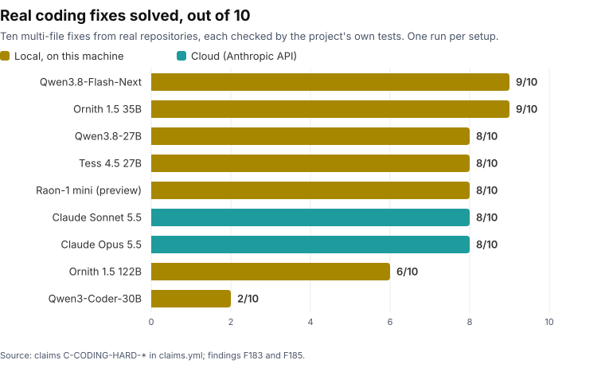

# Unattended work (r6.0)

**The question:** Can it finish a long, multi-step job while nobody watches?

**Why this kind of test:** Coding, because each project's own tests decide pass or fail, with no opinion involved. Office tool use is tested here too.

**Current answer:** 15/15 for the best local setups and Claude on the first 15 fixes; 9/10 on ten bigger fixes; 5/10 against GPT-6.1 Sol's 10/10 on ten large changes, and 1/10 with the tests hidden (5-19 Nov 2026).

## Coding results

<picture>
  <source media="(prefers-color-scheme: dark)" srcset="../assets/coding-results-dark.svg">
  
</picture>

Ten real multi-file fixes, scored by each project's own tests ([F183](../FINDINGS.md#f183), [F185](../FINDINGS.md#f185)),
at each model's default reasoning effort. A difference of one task is within noise. The harder result belongs beside
it: on ten large changes production solved 5 and GPT-6.1 Sol 10 ([F194](../FINDINGS.md#f194)); with the tests hidden,
both local setups solved 1 ([F195](../FINDINGS.md#f195)).

| Setup | Runs on | Solved | Median minutes per task |
|---|---|---|---|
| Qwen3.8-Flash-Next | Halogen 0.18.23 (this machine) | 9/10 | 21.3 |
| Ornith 1.5 35B | llama.cpp e14a7797 (this machine) | 9/10 | 30.4 |
| Qwen3.8-27B | Talus v0.1.3 (this machine) | 8/10 | 23.6 |
| Tess 4.5 27B | llama.cpp e14a7797, MTP draft (this machine) | 8/10 | 43.4 |
| Raon-1 mini (preview) | KRAFTON llama.cpp fork fb895662d (this machine) | 8/10 | 20.0 |
| Claude Sonnet 5.5 | Anthropic API (cloud) | 8/10 | 2.5 |
| Claude Opus 5.5 | Anthropic API (cloud) | 8/10 | 5.3 |
| Ornith 1.5 122B | llama.cpp e14a7797 (this machine) | 6/10 | 53.9 over 9 tasks (the 10th was stopped at the 70-minute limit and scored as a fail) |
| Qwen3-Coder-30B | llama.cpp 5851a8e (this machine) | 2/10 | 2.5 |

## Claims on this track (17)

Status, tested and reviewed dates come from [claims.json](../claims.json); [GLOSSARY.md](../GLOSSARY.md#claim-status) explains the terms. Experiment-by-experiment write-ups (why each was run, what would have changed the plan, what was decided) are being added track by track.

| Claim | Statement | Status | Tested | Evidence |
|---|---|---|---|---|
| C-FRONTIER-EVERYDAY-FIXES-001 | On 15 everyday real fixes from our own projects, production and Claude Sonnet 5.5 both solved all 15; Sonnet took a median 40s per fix (USD 1.23 for all 15), production 9.9 min, free and on the premises. | current | 2026-11-05 | [results/e154-results.md](../results/e154-results.md) |
| C-CODING-HARD-LOCAL-BEST-001 | On 10 harder real fixes from our own repositories (several files, hundreds of lines each, checked by the project's own tests in a sealed container), Qwen3.8-Flash-Next on Halogen running locally solved 9. One sample per task. | current | 2026-11-06 | [results/e156-results.md](../results/e156-results.md) |
| C-CODING-HARD-LOCAL-27B-001 | On the same 10 tasks, Qwen3.8-27B on Talus running locally solved 8. | current | 2026-11-06 | [results/e156-results.md](../results/e156-results.md) |
| C-CODING-HARD-CLOUD-SONNET-001 | On the same 10 tasks and harness, Claude Sonnet 5.5 (cloud) solved 8, for USD 2.82 across the 10 tasks. | current | 2026-11-06 | [results/e156-results.md](../results/e156-results.md) |
| C-CODING-HARD-CLOUD-OPUS-001 | On the same 10 tasks and harness, Claude Opus 5.5 (cloud) solved 8, for USD 7.75 across the 10 tasks. | current | 2026-11-06 | [results/e156-results.md](../results/e156-results.md) |
| C-CODING-HARD-ORNITH35-001 | On the same 10 real fixes, Ornith 1.5 35B (Q8_0, llama.cpp) running locally solved 9, level with Flash-Next, at a median 30.4 minutes per task. | current | 2026-11-07 | [results/e158-results.md](../results/e158-results.md) |
| C-CODING-HARD-TESS45-001 | On the same 10 real fixes, Tess 4.5 27B (Q8_0, llama.cpp) running locally solved 8. | current | 2026-11-07 | [results/e158-results.md](../results/e158-results.md) |
| C-CODING-HARD-RAON-001 | On the same 10 real fixes, KRAFTON's Raon-1 mini preview (Q8_0, KRAFTON's llama.cpp fork) running locally solved 8, at a median 20.0 minutes per task. | current | 2026-11-07 | [results/e158-results.md](../results/e158-results.md) |
| C-CODING-HARD-ORNITH122-001 | On the same 10 real fixes, Ornith 1.5 122B (Q5_K_M, llama.cpp) running locally solved 6, fewer than its 35B sibling: a bigger model was not better here. | current | 2026-11-07 | [results/e158-results.md](../results/e158-results.md) |
| C-FRONTIER-LARGE-CHANGES-001 | On 10 large real changes, Claude Sonnet 5.5, Opus 5.5 and Fable 5.2 each solved all 10 (median 3.3, 6.8 and 7.1 min), as did GPT-6.1 Sol (2.1 min); production solved 5 (11.4 min). Large multi-step changes are frontier work. | current | 2026-11-25 | [results/e178-results.md](../results/e178-results.md) |
| C-TOOLUSE-SERVING-001 | Out-of-the-box tool-use support is serving-config dependent, not just model dependent: on the same llama.cpp build the workhorse and gpt-oss-20b emit clean tool calls immediately, Mistral-Small-3.1 silently refuses until supplied a tool template its GGUF does not ship, and Qwen3-Coder leaks its native call format as unparseable text about 5% of the time. Choose a tool-use model by measured parse-reliability on your own stack, not by reputation. (F38, E33A.) | qualified | 2026-07-14 | [FINDINGS.md#f38](../FINDINGS.md#f38) |
| C-TOOLUSE-CONDITIONAL-001 | Judgement inside a tool call still needs a human check. Told to mark a document urgent only when a condition holds, every model tested also flagged cases where the condition was false (the negative branch fails). A 3-task test made Mistral look like the exception; the 13-task expansion reversed that (Mistral 38%, worst; Qwen3.8 at medium effort 86%, best). The mechanical step (make the file, send the message) is dependable. (F38, F73.) | qualified | 2026-08-16 | [FINDINGS.md#f73](../FINDINGS.md#f73) |
| C-CODING-RECOMMENDED-TIE-001 | Seven coding models recommended by a Strix Halo chat and a comparison widget (Qwen3.8-27B, Qwen3.8-Flash-Next, two quants of Qwen3.6-35B-A3B, Ornith 1.0 and 1.5, Qwen3.6-27B) tie with the incumbent Qwen3-Coder through Aider on three real repo tasks: 5 to 7 passes of 9 for every model against a pre-registered band of 4 for a real difference, with the incumbent 2x to 10x faster per attempt set. The widget's speed order held (its 'faster' option is 39% faster; it said 42%) and its 27B penalty did not (4.7x, it said 2.09x). Every failure on the task the incumbent passes carries only the seed diff: the other models' edits never reached the file (F171). | qualified | 2026-09-25 | [results/e145-results.md](../results/e145-results.md) |
| C-CODING-HARD-TIME-001 | The best local setup took a median of 21.3 minutes per task against 2.5 for Sonnet 5.5, about 8.6 times longer, at no per-task cost. One of its nine passes (99cb03e95) has weak tests that check source wording; without it the local leaders score 8 and 7 against 8 and 8 for the cloud. | qualified | 2026-11-06 | [results/e156-results.md](../results/e156-results.md) |
| C-CODING-DEFAULT | For local coding on real repository work, Qwen3.8-Flash-Next on Halogen is the recommended default (9/10 on 10 real multi-file fixes, median 21.3 min per task), with Ornith 1.5 35B on llama.cpp as fallback (9/10, 30.4 min); Qwen3-Coder-30B, the earlier default, solved 2/10. The document-suite workhorse is not suited to agentic coding. | qualified | 2026-11-07 | [results/e158-results.md](../results/e158-results.md) |
| C-TOOLUSE-DOC-001 | Given office tools (create a Word document, send an email, add a reminder, look up a client), the workhorse (Qwen3-30B-Instruct) called the correct tool on 91% of a broad 22-task suite (5 runs each) with zero malformed calls, producing real .docx files, and correctly answered plain questions in text without over-calling a tool. Tool use / document creation is real and reliable on the right model. (F38, experiments E32A-E33A.) | historical | 2026-07-14 | [FINDINGS.md#f38](../FINDINGS.md#f38) |
| C-CODING-HARD-INCUMBENT-001 | Qwen3-Coder-30B, the earlier local coding recommendation, solved 2 of the same 10 tasks; it stopped early (median 19 turns) rather than running out of time. | historical | 2026-11-06 | [results/e156-results.md](../results/e156-results.md) |
